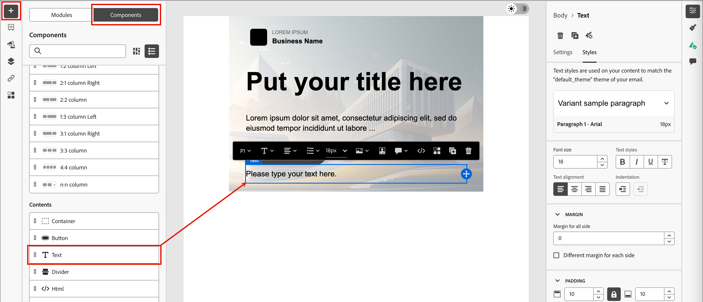

# 内容模块

使用[!DNL Adobe Marketo Optimizer]中的模块从准备好的布局中组合内容。 每个模块都将[结构](./structure-components.md)和[内容组件](./content-components.md)与您自己的文本、图像和链接替换的默认内容组合在一起。

与各个内容组件不同，模块提供完整的部分，如页眉、横幅、卡片和页脚。 将模块添加到画布，然后自定义其组件，而不是从空格构建每个部分。

模块不同于[可视化片段](./fragments.md)。 模块会成为您正在设计的内容的一部分。 可视化片段是保存的内容资产，您可以在电子邮件和电子邮件模板中重复使用。

## “模块”选项卡

在可视设计空间中，为以下任何内容类型使用&#x200B;**[!UICONTROL 模块]**&#x200B;选项卡：

* 电子邮件 — 请参阅&#x200B;[_电子邮件内容创作_](./email-authoring.md)。
* 登陆页面 — 请参阅&#x200B;[_登陆页面设计_](./landing-page-design.md)。
* 可视片段 — 请参阅&#x200B;[_片段创作_](./fragment-authoring.md)。
* 电子邮件模板 — 请参阅&#x200B;[_创建电子邮件模板_](./templates-create.md#build-new)。

可视化设计画布旁边显示的{width="600" zoomable="yes"}

## 模块类别

展开类别以选择布局。 这些版面为节内容提供了不同的排列方式，如一列、两列或三列。

| 类别 | 使用 |
| --- | --- |
| [!UICONTROL 标头] | 使用徽标、导航链接和介绍文本介绍您的内容。 |
| [!UICONTROL 英雄] | 突出显示具有横幅部分的公告或促销活动。 |
| [!UICONTROL 表扬] | 在样式化部分中显示客户报价。 |
| [!UICONTROL 卡片] | 在网格中排列产品、文章或其他内容项目。 |
| [!UICONTROL 团队] | 向团队成员、作者或演讲者介绍照片、姓名和角色。 |
| [!UICONTROL 页脚] | 使用导航链接、社交链接和法律文本完成您的内容。 |

## 添加和自定义模块

从与要创建的部分匹配的模块开始，然后调整其内容和样式。 将默认链接和文本替换为适合您的渠道的内容。

>[!NOTE]
>
>对于营销电子邮件，请包含选择退出链接，并在发布电子邮件之前[检查电子邮件提醒](../marketing/email-channel.md#alerts)。

1. 在可视设计空间中打开电子邮件、登陆页、可视片段或电子邮件模板。

   默认情况下，画布左侧将显示&#x200B;**[!UICONTROL 模块]**&#x200B;选项卡。

1. 要查看可用布局，请展开类别。

   您还可以使用搜索字段按名称查找模块。

1. 将模块拖动到画布上。

   {width="600" zoomable="yes"}

1. 查看模块中的元素。

   每个模块都包含您可以编辑的默认内容。 单击画布左侧的&#x200B;_导航树_&#x200B;图标（）以显示模块中的结构和元素。

   {width="600" zoomable="yes"}

1. Select是模块中用于自定义它的元素。

   您可以替换默认文本、从资源中选择图像以及更新内容的链接。

   使用&#x200B;**[!UICONTROL 设置]**&#x200B;和&#x200B;**[!UICONTROL 样式]**&#x200B;选项卡调整所选的组件。

   {width="600" zoomable="yes"}

1. 要添加其他元素，请选择&#x200B;**[!UICONTROL 组件]**&#x200B;选项卡，并将[内容组件](./content-components.md)拖入模块中。

   如果将组件添加到模块结构，则默认情况下会继承模块样式。 根据需要调整其样式。

   {width="800" zoomable="yes"}

1. 选择&#x200B;**[!UICONTROL 保存]**&#x200B;以保存更改。

>[!NOTE]
>
>将品牌主题应用于电子邮件内容时，模块将继承其样式。 当您[从头开始设计电子邮件时](./email-authoring.md#design-from-scratch)选择样式模式。

## 重用自定义模块内容

要生成可重用的模块内容，请[创建一个可视化片段](./fragments.md#create-fragments)，并在片段设计空间中添加和自定义模块。 保存并发布片段，以使其可用于电子邮件和电子邮件模板。

然后[将片段](./fragments.md#add-to-content)插入其他电子邮件或电子邮件模板中。
