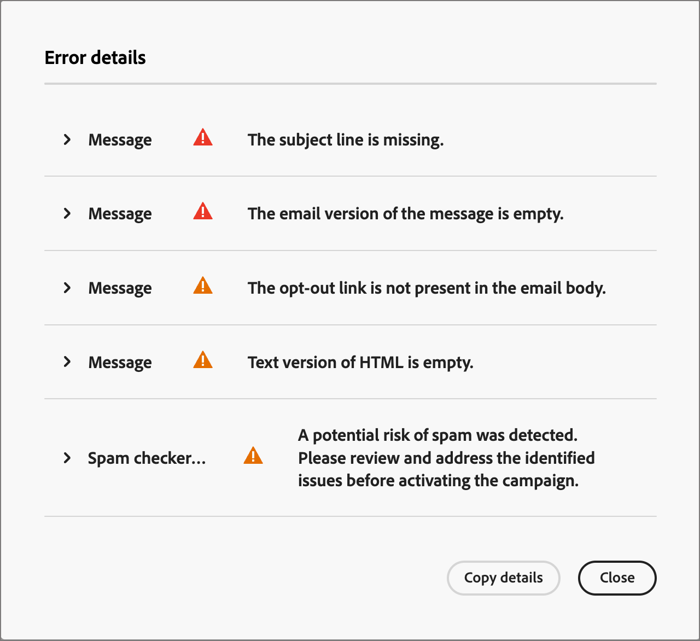
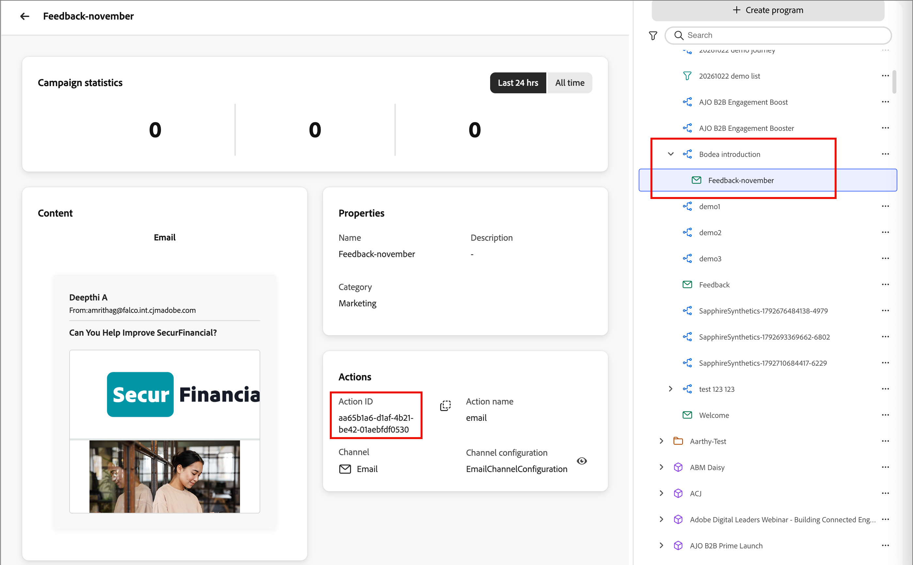

# 创建电子邮件并将它们添加到历程

[!DNL Adobe Marketo Optimizer]为B2B营销人员提供了现代的企业级电子邮件创作和投放体验，因此您可以从项目和历程创建、发布和发送电子邮件。

电子邮件是独立的资产，因此您无需历程即可创建电子邮件。 [在程序或程序的一个文件夹中创建电子邮件](#create-email-from-programs)，在程序准备就绪时[发布它](#publish-email)，然后[从该程序的任何历程中发送它](#add-email-from-journey)。

## 电子邮件生命周期 {#lifecycle}

电子邮件始终处于以下状态之一：

| State | 描述 |
| ----- | ----------- |
| **草稿** | 每封新电子邮件都以草稿开始，草稿在程序树中以红色信封图标显示。 您可以编辑其属性、操作和内容，还可以对其进行个性化、分析、重命名或删除。 |
| **已发布** | 已发布的电子邮件已锁定，可以发送，并且显示绿色信封图标。 它无法编辑或取消发布，当您在历程中选择电子邮件时，会列出它。 |
| **在历程中** | 当您在&#x200B;_发送电子邮件_&#x200B;操作中选择已发布的电子邮件时，将创建属于该历程的已发布副本。 该副本是只读的，如果后来复制和修订了原始副本，则该副本不会更改。 |

发布电子邮件时，该电子邮件会从草稿变为已发布。 为&#x200B;_发送电子邮件_&#x200B;操作节点选择后，历程中会保留副本。 若要更改已发布的电子邮件，请[复制它](#duplicate-email)。 副本将作为具有相同内容和设置的草稿创建。

{width="800" zoomable="yes"}

电子邮件状态决定了操作可用性：

| 操作 | 草稿 | 发布日期 | 在历程中 |
| ------ | ----- | --------- | ------------ |
| 编辑属性、操作和内容 | 是 | 否 | 否 |
| 使电子邮件个性化 | 是 | 否 | 否 |
| 分析电子邮件 | 是 | 否 | 否 |
| 发布 | 是，一旦阻塞警报得到解决 | 已发布 | 已自动发布 |
| 重复 | 是 | 是 | 否 |
| 重命名 | 是 | 否 | 不会。 选择副本时，请为其命名。 |
| 删除 | 是 | 否 | 不会。 请改为删除&#x200B;_发送电子邮件_&#x200B;节点。 |
| 在历程中选择 | 否 | 是 | 不适用 |

## 先决条件 {#before-you-begin}

确保您的用户角色包括您执行的任务的以下[产品权限](../start/permissions-reference.md)：

* **[!UICONTROL 查看B2B程序]**&#x200B;和&#x200B;**[!UICONTROL 查看B2B文件夹]** — 查看电子邮件所在的程序和文件夹。
* **[!UICONTROL 查看B2B电子邮件]** — 查看电子邮件。
* **[!UICONTROL 管理B2B电子邮件]** — 创建、编辑、复制、重命名、删除和发布电子邮件。
* **[!UICONTROL 管理B2B人员历程]** — 在人员历程中添加或替换电子邮件操作。 若要以只读方式访问历程，请使用&#x200B;**[!UICONTROL 查看B2B人员历程]**。
* **[!UICONTROL 管理B2B对话体验]** — 访问[!DNL Coworker]以个性化或分析电子邮件。 [!DNL Coworker]中的操作还需要相应的电子邮件权限。

仅当您执行以下相关设置或发送任务时，才需要其他权限：

* **[!UICONTROL 管理B2B程序]** — 创建一个程序（如果尚不存在）。
* **[!UICONTROL 管理B2B渠道配置]**&#x200B;和&#x200B;**[!UICONTROL 查看B2B电子邮件设置]** — 创建电子邮件渠道配置。 管理员还需要&#x200B;**[!UICONTROL 管理B2B电子邮件设置]**&#x200B;来配置电子邮件投放设置。
* **[!UICONTROL 发布B2B人员历程]** — 发布发送电子邮件的历程。

在创建电子邮件之前，请确认以下各项：

* 电子邮件驻留在程序或其某个文件夹中。 在创建电子邮件之前定义项目。 历程只能从其自己的项目发送电子邮件。
* 要选择电子邮件渠道配置，请使用电子邮件&#x200B;**[!UICONTROL 操作]**&#x200B;选项卡。 管理员管理[电子邮件渠道配置](../admin/email-channel-configuration.md)。
* 您可以在程序中创建所需数量的电子邮件。

>[!NOTE]
>
>如果您是第一次发送电子邮件，请确保已配置[电子邮件可投放性](../start/email-deliverability.md)和所需的[电子邮件渠道](../admin/email-channel-configuration.md)。

<!-- 
* **Email channel configurations** - Manage the sender identity, reply behavior, marketing vs. transactional message types, and tracking.
* **Email deliverability controls** - Set up your email deliverability channel, including subdomain delegation (Fully Delegated and CNAME methods), DMARC, SPF/DKIM auto-configuration, and shared IP pool support.
* **Send Email action** - From a journey, add a _Send email_ action node, including personalization using profile attributes (Handlebars syntax).
* **Visual drag-and-drop email design tools** -  Design your email content with structures, content components, themes, dark-mode support, and reusable visual fragments.
* **Marketo Design Studio assets** — Choose images and assets from a one-time copy of your Marketo Engage asset library directly inside the email canvas.
* **Reusable templates and fragments** — Save common headers, footers, CTAs, and full email layouts and reuse them across journeys.
* **Role-Based Access Control (RBAC)** — Apply granular permissions for creating, editing, approving, and sending email. 
-->

>[!BEGINSHADEBOX]

## 当前限制 {#limitations}

* **测试用户档案、模拟内容和发送校样**&#x200B;在当前版本中不可用。 Litmus呈现和基于SpamAssassin的垃圾邮件报告计划在未来版本中发布。
* **帐户级别的个性化和自定义对象数据**&#x200B;在当前版本中不可用。 使用配置文件属性。
* 现有[!DNL Marketo Engage]模板的&#x200B;**Velocity-to-Handlebars自动迁移**&#x200B;可根据请求提供。
* **电子邮件注释和协作**（内联注释、@mentions、请求审阅工作流）计划在未来版本中发布。
* 计划在将来的版本中集成&#x200B;**AEM Assets、AEM内容片段和Adobe Express**。

>[!ENDSHADEBOX]

## 重要概念 {#key-concepts}

在为人员历程创建电子邮件并创作电子邮件内容之前，请查看以下概念：

| 概念 | 在[!DNL Adobe Marketo Optimizer] |
| ------- | ---------------------- |
| **_[电子邮件设计空间](../content/email-authoring.md#email-design-tools)_** | 用于撰写电子邮件内容的可视化画布和设计工具。 它包括拖放布局组件、模板、片段、主题和个性化编辑器。 |
| **_[模板](../content/templates.md)_** | 可用于创建新电子邮件的可重用电子邮件布局。 模板可以是Adobe提供的内置示例模板，也可以是您的团队创建的自定义模板。 |
| **_[可视片段](../content/fragments.md)_** | 可插入到多个电子邮件中的可重用内容块（例如页眉、页脚、CTA、法律免责声明）。 更新片段会将更改传播到使用它的每封电子邮件。 |
| **_[主题](../content/email-authoring.md#design-from-scratch)_** | 可在电子邮件中应用的可重用样式预设（颜色、排版规则、间距、按钮样式）。 |
| **_[Personalization令牌](../content/personalization-expressions.md)_** | 发送时，使用每个收件人的配置文件数据解析的Handlebars表达式（例如`{{profile.firstName}}`）。 |
| **_[独立电子邮件](#lifecycle)_** | 独立于任何历程存在的电子邮件资产。 它是在程序或其中一个文件夹中创建的，并从草稿移至已发布。 |
| **_[电子邮件类型](#email-types)_** | 创建电子邮件时选择的分类，**[!UICONTROL 营销]**&#x200B;或&#x200B;**[!UICONTROL 事务型]**。 它告知[!DNL Marketo Optimizer]如何出于同意目的处理消息。 |
| **_[发送电子邮件操作](./action-nodes.md#add-an-action-node)_** | 历程操作节点，它使用渠道配置和电子邮件内容来投放电子邮件。 |

## 电子邮件类型 {#email-types}

创建电子邮件时，您可以选择其类型。 该类型告诉[!DNL Marketo Optimizer]如何出于同意目的处理该消息，因此请选择与发送该消息的原因匹配的类型。

| 类型 | 用于 |
| ---- | ------- |
| **[!UICONTROL 营销]** | 促销消息，如产品发布公告、新闻稿或活动邀请。 |
| **[!UICONTROL 事务性]** | 人员因执行操作而预期的运营报文，如订单、注册或发运确认。 |

该类型在&#x200B;**[!UICONTROL 属性]**&#x200B;选项卡上显示为电子邮件&#x200B;**[!UICONTROL 类别]**。

## 在程序树中创建电子邮件 {#create-email-from-programs}

在程序或文件夹中创建电子邮件，以独立于任何历程对其进行构建。

1. 在左侧导航栏中，展开&#x200B;**[!UICONTROL 营销管理]**，然后选择&#x200B;**[!UICONTROL 程序]**。

1. 在程序树中，单击&#x200B;_更多_&#x200B;图标(**...**) 在要创建电子邮件的程序或文件夹旁边，选择&#x200B;**[!UICONTROL 创建电子邮件]**。

   {width="400"}

1. 在&#x200B;_[!UICONTROL 创建电子邮件]_&#x200B;对话框中，完成以下字段：

   * **[!UICONTROL 父项]** — （必需）保存电子邮件的程序或文件夹。 它会设置为您启动的程序，您可以将其更改为其他程序或程序的文件夹之一。

   * **[!UICONTROL 电子邮件类型]** — 选择&#x200B;**[!UICONTROL 营销]**&#x200B;或&#x200B;**[!UICONTROL 事务性]**（请参阅[电子邮件类型](#email-types)）。

   * **[!UICONTROL 名称]** — （必需）输入在程序树中标识电子邮件的名称。

   * **[!UICONTROL 描述]** — （可选）为团队输入有关电子邮件及其用途的注释。

   {width="400"}

1. 单击&#x200B;**[!UICONTROL 创建]**。

电子邮件在其自己的选项卡中打开，并作为草稿显示在程序树中的程序下。 当电子邮件打开时，任何[!DNL Coworker]提示都将被限定在该电子邮件的范围内。

接下来，[设置电子邮件](#define-email-properties)、[解决所有警报](#alerts)和[发布它](#publish-email)。

### 定义电子邮件属性和操作 {#define-email-properties}

草稿电子邮件有三个选项卡： **[!UICONTROL 属性]**、**[!UICONTROL 操作]**&#x200B;和&#x200B;**[!UICONTROL 内容]**。 按顺序处理这些更改，然后保存更改。 在程序树中创建电子邮件时，将打开电子邮件页面。 要稍后打开草稿，请在程序树中选择电子邮件。

#### 填写属性和操作选项卡 {#properties-actions-tabs}

1. （可选）在&#x200B;**[!UICONTROL 属性]**&#x200B;选项卡中，输入&#x200B;**[!UICONTROL 描述]**&#x200B;以及要为电子邮件捕获的任何其他描述性信息。

   {width="800" zoomable="yes"}

1. 选择&#x200B;**[!UICONTROL 操作]**&#x200B;选项卡并完成电子邮件的功能设置：

   * **[!UICONTROL 电子邮件]** — 选择或创建要使用的&#x200B;**[!UICONTROL 电子邮件渠道配置]**。

     这是一组可重复使用的电子邮件投放设置，用于定义发件人身份、回复地址、子域、IP池、电子邮件类型（营销或事务性）以及跟踪。 单击&#x200B;_查看_&#x200B;图标以查看所选配置的设置。

     管理员在[电子邮件渠道配置](../admin/email-channel-configuration.md)中创建配置。

   * **[!UICONTROL 业务规则]** — （可选）通过选择规则集将上限或无提示小时规则应用于您的电子邮件操作。

     有关业务规则以及如何定义和激活渠道通信的规则集的详细信息，请参阅&#x200B;[_业务规则_](../admin/business-rules.md)。

   * **[!UICONTROL 操作跟踪]** — 选中要跟踪电子邮件的操作的复选框。

   {width="600" zoomable="yes"}

#### 添加主题行和内容 {#content-tab}

1. 单击&#x200B;**[!UICONTROL 编辑内容]**，或选择&#x200B;**[!UICONTROL 内容]**&#x200B;选项卡。

   {width="500" zoomable="yes"}

1. 输入要显示在电子邮件主题字段中的&#x200B;**[!UICONTROL 主题行]**&#x200B;文本。

   主题行为必填项。

   单击&#x200B;_个性化_&#x200B;图标（）以在字段中使用个性化令牌。

1. （可选）选中&#x200B;**[!UICONTROL 优化HTML大小]**&#x200B;复选框以在发布过程中减小电子邮件HTML的大小。

   这有助于防止在Gmail等客户端中剪切电子邮件。 Gmail对超过100 KB的邮件进行截断。 有关详细信息，请参阅&#x200B;[_优化电子邮件HTML大小_](#optimize-html-size)。

1. 单击&#x200B;**[!UICONTROL 编辑电子邮件正文]**&#x200B;以访问可视化设计工具并开始[生成您的内容](../content/email-authoring.md)。

   或者，您可以单击&#x200B;**[!UICONTROL 代码编辑器]**，以纯HTML对您自己的内容进行编码。 如果您已有HTML可重复用于电子邮件设计，则可以将其复制并粘贴到编辑器中。

### 检查警报 {#alerts}

电子邮件标头中的&#x200B;**[!UICONTROL 警报]**&#x200B;按钮显示[!DNL Adobe Marketo Optimizer]发现了多少问题。 单击该图标以显示列表。

{width="450"}

警报有两种类型：

* **阻止问题** — 当这些问题保留时，**[!UICONTROL 发布]**&#x200B;不可用，电子邮件的&#x200B;_更多_&#x200B;菜单显示&#x200B;**[!UICONTROL 解决电子邮件警报以进行发布]**。 请在发布电子邮件之前解决所有阻止问题。

  示例包括：

  * 发件人名称为空
  * 缺少主题行
  * 电子邮件内容为空

* **警告** — 这些指出了值得查看的内容，但不会阻止您发布。 如果其余警报为警告，则电子邮件可以显示警报，但仍会发布。

  示例包括：

  * 电子邮件正文中不存在选择退出链接
  * HTML的文本版本为空
  * 检测到空链接
  * 电子邮件超过100 K

## 在程序树中管理电子邮件 {#manage-emails}

电子邮件会以信封图标显示在程序树中。 红色信封标记草稿。 绿色信封标记已发布的电子邮件。 单击&#x200B;_更多_&#x200B;图标(**...**) ，以对其进行管理。

程序树中的{width="400"}

草稿电子邮件的菜单包括&#x200B;**[!UICONTROL 发布]**、**[!UICONTROL 个性化电子邮件]**、**[!UICONTROL 分析电子邮件]**、**[!UICONTROL 重复]**、**[!UICONTROL 重命名]**&#x200B;和&#x200B;**[!UICONTROL 删除]**。

对于已发布的电子邮件，**[!UICONTROL 复制]**&#x200B;是唯一选项。

### 个性化和分析电子邮件 {#personalize-analyze}

虽然电子邮件是草稿，但其&#x200B;_更多_&#x200B;菜单包含两个内容工具。 请在发布之前运行它们，因为已发布的电子邮件无法更改。

* **[!UICONTROL 个性化电子邮件]** — 在加载电子邮件的情况下打开[!DNL Coworker]。 要向电子邮件添加个性化内容，请描述目标组。 有关详细信息，请参阅&#x200B;[_按角色个性化电子邮件内容_](../agents/personalize-content.md)。

  {width="700" zoomable="yes"}

* **[!UICONTROL 分析电子邮件]** — 查看您已创建的内容。 请参阅[分析现有电子邮件](../agents/personalize-content.md#analyze-existing-email)。

### 发布电子邮件 {#publish-email}

在电子邮件准备发送时发布。 当您[在历程中选择电子邮件](#add-email-from-journey)时，仅列出已发布的电子邮件。

1. 确保电子邮件没有阻止[警报](#alerts)。

1. 在程序树中，单击&#x200B;_更多_&#x200B;图标(**...**) 在该电子邮件旁边，然后选择&#x200B;**[!UICONTROL 发布]**。

1. 在&#x200B;_[!UICONTROL 发布电子邮件]_&#x200B;确认对话框中，单击&#x200B;**[!UICONTROL 发布]**。

   {width="400"}

电子邮件图标变为绿色。 如果选择电子邮件，则它会以只读视图打开，并汇总其内容、属性和操作。

{width="700" zoomable="yes"}

>[!IMPORTANT]
>
>发布是永久性的。 无法编辑、重命名、删除已发布的电子邮件或将其返回到草稿。 要进行更改，[复制电子邮件](#duplicate-email)。

### 复制电子邮件 {#duplicate-email}

要更改已发布的电子邮件，请复制该电子邮件。 要尝试变体而不更改原始变体，您还可以复制草稿。

1. 在程序树中，单击&#x200B;_更多_&#x200B;图标(**...**) 在该电子邮件旁边，然后选择&#x200B;**[!UICONTROL 复制]**。

1. 在&#x200B;_[!UICONTROL 重复的电子邮件]_&#x200B;对话框中，根据需要更改&#x200B;**[!UICONTROL 名称]**。

   它默认为原始名称，后跟`_copy`。 （可选）添加&#x200B;**[!UICONTROL 描述]**。

   {width="400"}

1. 单击&#x200B;**[!UICONTROL 复制]**。

副本将作为具有相同内容和设置的草稿创建。 进行更改，然后发布。

## 向历程添加电子邮件 {#add-email-from-journey}

要发送电子邮件，请将其添加到同一程序中的历程。 当您选择电子邮件时，[!DNL Marketo Optimizer]会为该历程制作一份电子邮件副本，并自动发布该副本。 电子邮件来自程序树，因此[首先创建和发布电子邮件](#create-email-from-programs)。

您可以在多个历程中使用同一电子邮件。 每次选择它时，都会为该历程创建一个单独的副本，您可以为每个副本指定一个唯一的名称。

### 为“发送电子邮件”操作选择电子邮件 {#select-email-in-journey}

1. 打开历程，然后选择或添加&#x200B;[_执行操作_&#x200B;节点](action-nodes.md#add-an-action-node)。

1. 在&#x200B;_[!UICONTROL 选择操作]_&#x200B;中，选择&#x200B;**[!UICONTROL 发送电子邮件]**。

1. 在&#x200B;_[!UICONTROL 电子邮件源]_&#x200B;下，选择下列选项之一：

   * **[!UICONTROL 从程序树中选择电子邮件]** — 选择此选项可使用历程的程序或其文件夹中发布的电子邮件。

   * **[!UICONTROL 使用AI个性化电子邮件]** — 选择此选项可使用AI生成的电子邮件。 这些电子邮件已得到优化，以便AI辅助收件箱客户将其摘要和答案加入您的优惠和行动号召中。

   {width="600"}

   在选择电子邮件之前，该节点显示空白的电子邮件名称。

1. 单击&#x200B;**[!UICONTROL 选择电子邮件]**。

   * **_程序树电子邮件:_**&#x200B;在&#x200B;_[!UICONTROL 选择电子邮件]_&#x200B;对话框中，查找并选择电子邮件。

     如果需要，请使用&#x200B;**[!UICONTROL 搜索电子邮件]**&#x200B;进行筛选。 在列表中选择要预览的电子邮件并检查主题行。

     {width="600" zoomable="yes"}

     >[!NOTE]
     >
     >该对话框仅列出历程程序及其文件夹中已发布的电子邮件。 在您[发布草稿之前](#publish-email)不会显示草稿。 如果电子邮件未显示，请检查它是否具有已发布的（绿色图标），以及它是否位于正确的项目中。

     在&#x200B;**[!UICONTROL Name]**&#x200B;中，输入电子邮件在历程中应具有的名称。

     它默认为原始名称，后跟`_copy`。 将其重命名为历程上下文中合理的名称。

   * **_AI个性化电子邮件:_**&#x200B;在&#x200B;_[!UICONTROL 选择AI生成的电子邮件]_&#x200B;对话框中，查找并选择个性化电子邮件。

     从列表中选择个性化电子邮件。 该对话框列出了存储在AI库中的&#x200B;_AI个性化电子邮件_。 有关更多信息，请参阅按角色个性化电子邮件内容。

     {width="450" zoomable="yes"}

1. 单击&#x200B;**[!UICONTROL 选择]**。

### 历程电子邮件副本 {#journey-copy}

副本将添加到历程，并发布到程序树中的历程下，其中显示一个橙色图标。 它具有自己的操作ID，并且是只读的。

在程序树中{width="700" zoomable="yes"}

历程会保留自己的副本。 内容和配置将在您选择电子邮件时复制。 如果您稍后复制并修订原始版本，则现有历程将继续发送复制的版本。

对于可选[发送时间优化](email-send-time-optimization.md)，请在选择电子邮件后配置历程操作节点。

### 在历程中更新电子邮件 {#update-email-in-journey}

由于历程的副本是只读的，因此您可以替换而不是编辑它。

1. [复制](#duplicate-email)已发布的原始电子邮件，对草稿进行更改，然后[发布它](#publish-email)。

1. 在历程中，选择&#x200B;_发送电子邮件_&#x200B;节点，并使用&#x200B;_执行操作_&#x200B;面板中的垃圾桶图标将其删除。

1. 添加新的&#x200B;_发送电子邮件_&#x200B;操作并替换更新后的电子邮件。

## 优化电子邮件 HTML 大小 {#optimize-html-size}

>[!CONTEXTUALHELP]
>id="ajo-b2b-prime_email_minification"
>title="减小 HTML 大小"
>abstract="启用此选项后，系统将在发布时通过移除不必要的空白字符、缩进和非必要注释来压缩电子邮件 HTML。 这有助于防止在Gmail等客户端中剪切电子邮件。 Gmail对超过100 KB的邮件进行截断。"

[!DNL Marketo Optimizer]允许您在发布过程中通过删除不必要的空格、缩进和非必要的注释来压缩电子邮件HTML版本。 缩小HTML的规模可帮助您：

* 避免&#x200B;**电子邮件剪辑** — 某些客户端（如Gmail）截断大于~100 KB的邮件，从而阻止收件人查看完整内容。
* 改进收件人收件箱中的&#x200B;**电子邮件加载时间**。
* 改进&#x200B;**可投放性**&#x200B;并减少带宽使用。

此优化不会自动应用 — 必须在&#x200B;_[!UICONTROL Content]_&#x200B;选项卡中启用它。

<!--  -->

>[!IMPORTANT]
>
> HTML大小缩减仅在发布时应用。

优化是电子邮件客户端安全的：

* 它保留MSO/Outlook条件注释。
* 它不会更改您的实际内容、图像或视频。

>[!NOTE]
>
>电子邮件大小的缩减取决于电子邮件原始HTML结构。 如果内容已紧凑或电子邮件有效负载非常大，则缩减量可能最小，并且可能无法完全阻止剪辑。

<!-- 
Proof and simulate workflows are not available in this release. See [Current limitations](#limitations).

### Test HTML size optimization {#optimize-html-proof}

If you have enabled the [HTML size optimization](#optimize-html-size) option, you can evaluate its impact before publishing when sending proofs. Follow the following steps.

1. In the email design space, click the _Issues_ icon on the top right. If the rendered email size exceeds 100 KB, a message is displayed to warn you that this may cause truncation in some email clients.

1. Click **[!UICONTROL Simulate content]**.

1. To test the optimized version, click the **[!UICONTROL Send proof]** button and select the **[!UICONTROL Optimize HTML size]** option. This will send a proof with the reduced HTML size to your test recipients.

    >[!NOTE]
    >
    >This setting is independent from the email editor — the proof reflects what you select in the proof, regardless of whether the option is enabled or disabled in the email itself.

1. Select the test recipients and click **[!UICONTROL Send proof]**.

1. Back in the **[!UICONTROL Simulate]** screen, click the **[!UICONTROL View Proof]** button.

1. Click the _Information_ icon next to the status of the proof.

   The optimization details are displayed in a pop-up window, including the original HTML size, the optimized HTML size, and the size reduction percentage.
    
    Use this information to validate the optimized output and confirm the email stays within the recommended 100 KB threshold before publishing.

-->
