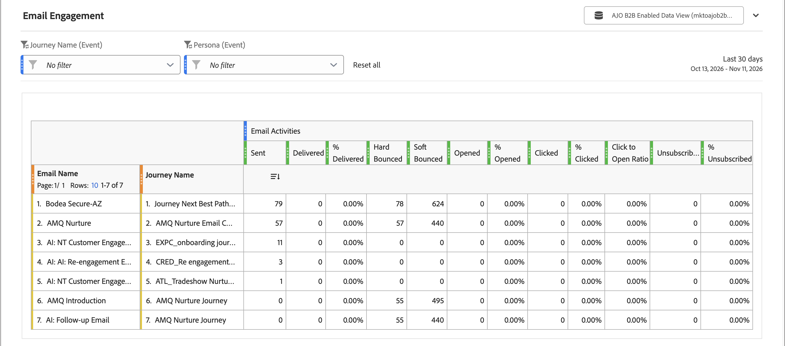
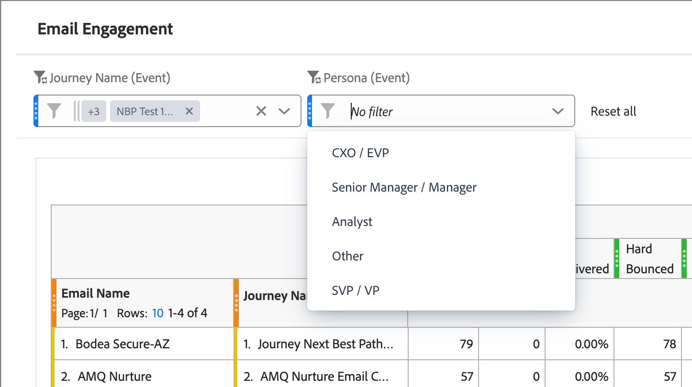

# 电子邮件参与报告

<!-- SPHR-32511: Filter by Program, Filter by Audience, and the program data point for the email performance table are not documented here pending delivery. -->

使用[!UICONTROL 电子邮件参与度]报告查看按电子邮件和历程细分的整个实例的电子邮件可投放性和参与度性能。

查看报告(_T):_

1. 在左侧导航中，选择&#x200B;**[!UICONTROL 报表]**。
1. 单击&#x200B;_列表_&#x200B;图标（）并在&#x200B;_[!UICONTROL 目录]_&#x200B;面板中选择&#x200B;**[!UICONTROL 电子邮件参与]**。

{width="700" zoomable="yes"}

使用报告顶部的&#x200B;**[!UICONTROL 历程名称（事件）]**&#x200B;和&#x200B;**[!UICONTROL 角色（事件）]**&#x200B;筛选器来缩小电子邮件数据范围。 打开筛选器列表并选择要包含的值。 查看[筛选器](#filters)。

您可以[使用在其他报表节上可用的相同日期范围选取器更改日期范围](./reports-overview.md#change-the-date-range)。

选择报表顶部的&#x200B;**[!UICONTROL 共享]**&#x200B;以下载或计划导出所有报表数据。 请参阅报告概述中的&#x200B;[_导出报告_](./reports-overview.md#export-a-report)。

## 报告表 {#report-table}

[!UICONTROL 电子邮件参与度]报表为每封电子邮件显示一行，行维度如下。

* **[!UICONTROL 电子邮件名称]** — 电子邮件的名称。
* **[!UICONTROL 历程名称]** — 发送电子邮件的历程的名称。

量度列在&#x200B;**[!UICONTROL 电子邮件活动]**&#x200B;下分组。

| 列 | 描述 |
| --- | --- |
| [!UICONTROL 已发送] | 已发送的电子邮件数。 |
| [!UICONTROL 已投放] | 投放的电子邮件数。 |
| [!UICONTROL %已投放] | 已送达的已发送电子邮件的百分比。 |
| [!UICONTROL 硬退回] | 永久无法投放的电子邮件数。 |
| [!UICONTROL 软退回] | 暂时无法投放的电子邮件数。 |
| [!UICONTROL 已打开] | 收件人打开电子邮件的次数。 |
| [!UICONTROL %已打开] | 打开的已投放电子邮件的百分比。 |
| [!UICONTROL 已单击] | 收件人单击电子邮件中链接的次数。 |
| [!UICONTROL %已点击] | 收到点击的已投放电子邮件的百分比。 |
| [!UICONTROL 单击以打开比率] | 收到点击的已打开电子邮件的百分比。 |
| [!UICONTROL 已取消订阅] | 取消订阅电子邮件的收件人数量。 |
| [!UICONTROL %已取消订阅] | 导致取消订阅的已投放电子邮件的百分比。 |

## 过滤器 {#filters}

使用筛选器按历程或角色缩小报表范围。

* **[!UICONTROL 历程名称（事件）]** — 按发送电子邮件的历程筛选。 默认值为[!UICONTROL 无筛选器]。
* **[!UICONTROL 角色（事件）]** — 按与电子邮件关联的[派生角色](../audiences/personas.md#filter-by-derived-persona)进行筛选。 默认值为[!UICONTROL 无筛选器]。

{width="500" zoomable="yes"}

选择&#x200B;**[!UICONTROL 全部重置]**&#x200B;以清除每个筛选器并返回默认视图。