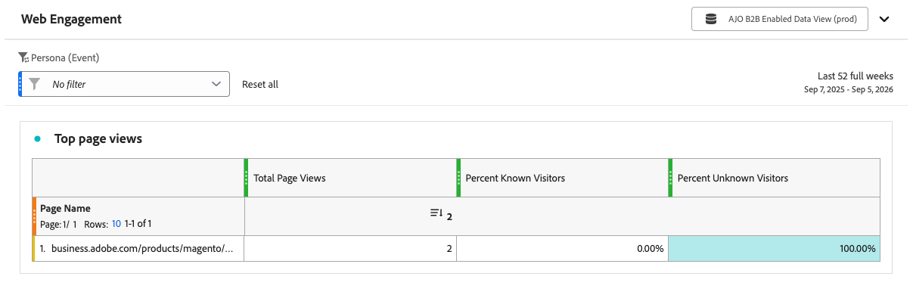
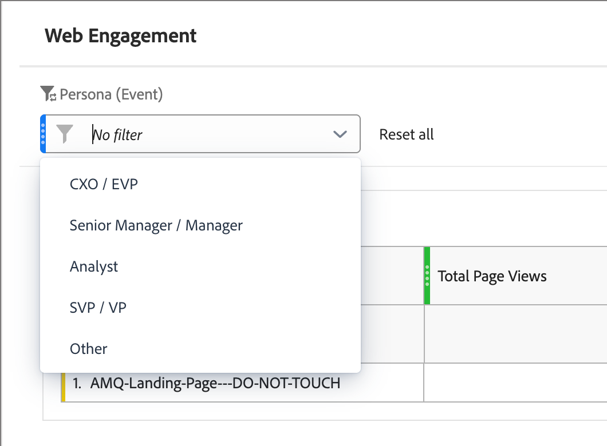

# Web参与报告

<!-- SPHR-39571: Audience, Company Name, Company Industry, and Region filters, plus the report title/subtitle rename, are planned under SPHR-32471 (not yet shipped) and should be documented separately once delivered  -->

使用[!UICONTROL Web参与度]报告查看实例中最受欢迎的交互式网络研讨会的参与度。

查看报告(_T):_

1. 在左侧导航中，选择&#x200B;**[!UICONTROL 报表]**。
1. 单击&#x200B;_列表_&#x200B;图标（）并在&#x200B;_[!UICONTROL 目录]_&#x200B;面板中选择&#x200B;**[!UICONTROL Web参与]**。

{width="700" zoomable="yes"}

您可以[更改报告的日期范围](./reports-overview.md#change-the-date-range)。

选择报表顶部的&#x200B;**[!UICONTROL 共享]**&#x200B;以下载或计划导出所有报表数据。 请参阅报告概述中的&#x200B;[_导出报告_](./reports-overview.md#export-a-report)。

## 报告表 {#report-table}

[!UICONTROL Web参与度]报表显示实例中查看次数最多的前10个页面，并具有以下行维度。

* **[!UICONTROL 页面名称]** — 网页的名称。

| 列 | 描述 |
| --- | --- |
| 总页面查看次数 | 页面的查看总数。 |
| [!UICONTROL 百分比已知访客] | 来自已知访客的查看次数百分比。 |
| [!UICONTROL 未知访客百分比] | 来自未知访客的查看次数百分比。 |

## 过滤器 {#filters}

使用报告顶部的&#x200B;**[!UICONTROL 角色（事件）]**&#x200B;筛选器以缩小页面查看数据范围。 打开筛选器列表并选择要包含的值。

* **[!UICONTROL 角色（事件）]** — 按与页面查看关联的[派生角色](../audiences/personas.md#filter-by-derived-persona)进行筛选。 默认值为[!UICONTROL 无筛选器]。

{width="500" zoomable="yes"}

选择&#x200B;**[!UICONTROL 全部重置]**&#x200B;以清除筛选器并返回默认视图。

>[!NOTE]
>
>计划在未来的版本中推出受众、公司名称、公司行业和区域的过滤器。
